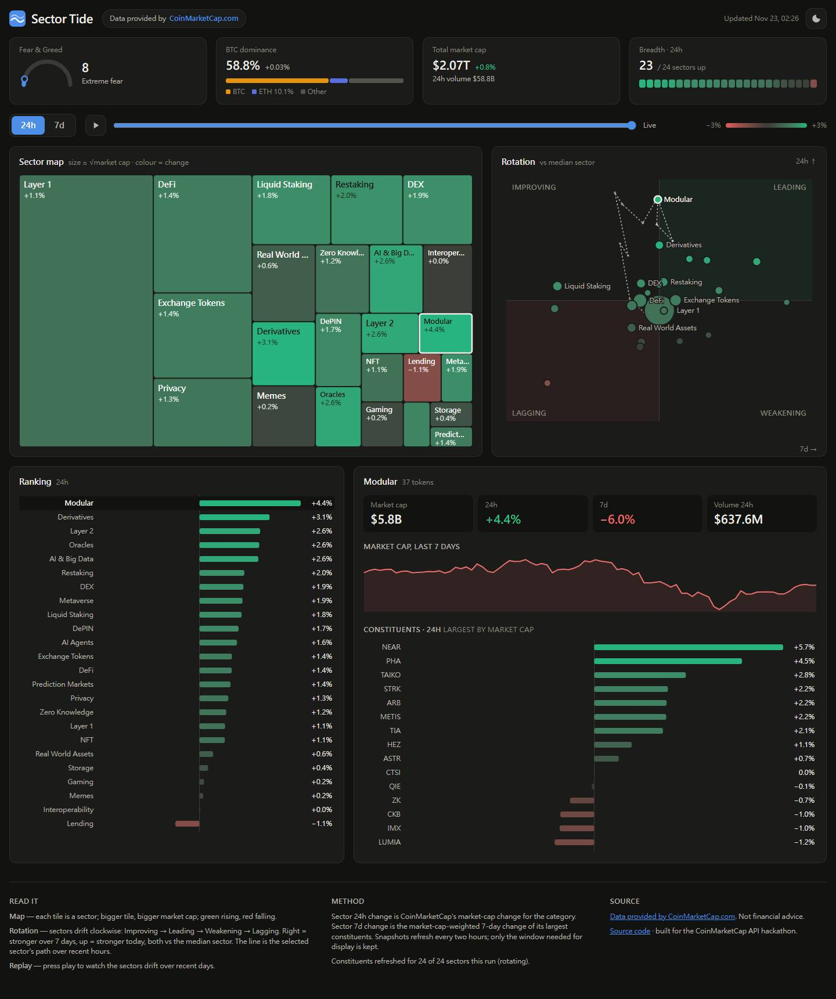

# Sector Tide

**Which crypto sectors are gaining, and which are fading?** Sector Tide turns CoinMarketCap category data into a rotation map. You can see which sectors are leading, which are losing momentum, and how they have drifted over the past week.

**Track:** Data and Visualisation · CoinMarketCap API Hackathon, Round 2

> Data provided by [CoinMarketCap.com](https://coinmarketcap.com/)



## What you see

| View | Encoding | Question it answers |
|---|---|---|
| **Sector map** | Treemap. Tile area ≈ √ market cap, colour = 24h or 7d change | Where is the money, and is it rising? |
| **Rotation** | Quadrant. x = 7d change vs the median sector, y = 24h change vs the median sector, bubble = market cap. A dotted path traces the selected sector's last 24h | Which sectors are *Improving → Leading → Weakening → Lagging*? |
| **Ranking** | Diverging bars | Strict order, with exact numbers |
| **Sector detail** | 7-day market cap line, plus the largest constituents as diverging bars | Who is pulling the sector up or down? |
| **Context** | Fear & Greed gauge, BTC/ETH dominance split, total market cap, breadth (sectors up / total) | Is this rotation, or just the whole market moving? |
| **Replay** | Scrubber and play button over the rolling 7-day history | How did we get here? |

The layout is mobile-native. Phones get tabbed views, slim bars and a taller treemap, not a shrunken desktop page. Light and dark themes follow the system setting, and a toggle overrides it.

## How it works

```
GitHub Actions (every 2h)                         GitHub Pages (static)
 ├─ restore last deployed snapshot.json/history.json
 ├─ fetch/fetch.mjs  ──►  CoinMarketCap API (key from Actions secret, header only)
 │     writes display-only JSON
 ├─ vite build
 └─ deploy-pages  ─────────────────────────────►  index.html + data/*.json
                                                    browser reads JSON, no key
```

- **No API key in the browser or in git.** The key exists only as the `CMC_API_KEY` Actions secret, or as an environment variable for local runs, and is sent only in the `X-CMC_PRO_API_KEY` header.
- **No data in git.** Snapshots live only inside the deployed Pages artifact. Each run restores the previously deployed files and keeps a rolling 7-day window of derived numbers for display. It does not store raw API responses (see *Licence note*).
- **Credit guard.** Each run first calls `/v1/key/info` (0 credits). If the monthly balance is below `MIN_CREDITS_LEFT`, the run is skipped and the last snapshot stays live. Constituent drill-downs rotate four sectors per run, so each sector refreshes every ~12h.
- **Graceful failure.** If the fetch fails, the previous snapshot is redeployed unchanged.

## CoinMarketCap endpoints used

| Endpoint | Used for | Credits / run |
|---|---|---|
| `GET /v1/key/info` | credit guard | 0 |
| `GET /v1/cryptocurrency/categories` | sector market cap, 24h market-cap change, volume | 1 |
| `GET /v1/cryptocurrency/category?id=` | constituents with `percent_change_24h/7d` → cap-weighted sector 7d change and leaders/laggards | 1 per sector drilled (4) |
| `GET /v1/global-metrics/quotes/latest` | total market cap, BTC/ETH dominance and their 24h change | 1 |
| `GET /v3/fear-and-greed/latest` | sentiment context | 1 |
| `GET /v2/cryptocurrency/quotes/historical` | one-off 7-day backfill of rotation history (`fetch/backfill.mjs`) | ≈75, once |

About **7 credits per run**, 12 runs a day.

## Real API calls (evidence)

The request, from [`fetch/fetch.mjs`](fetch/fetch.mjs). The key is read from the environment and never logged:

```js
async function cmc(path, label) {
  const res = await fetch(BASE + path, { headers: { 'X-CMC_PRO_API_KEY': KEY, Accept: 'application/json' } });
  const body = await res.json().catch(() => null);
  const st = body?.status ?? {};
  if (!res.ok || +(st.error_code ?? 0) !== 0) throw new Error(`${label}: HTTP ${res.status} ${redact(st.error_message ?? '')}`);
  credits += +(st.credit_count ?? 0);
  return body.data;
}
const cats = await cmc('/v1/cryptocurrency/categories?limit=5000', 'categories');
```

Response excerpts captured on 2026-11-22 18:24 UTC. Arrays are truncated, and none of the excerpts contains a key.

`GET /v1/cryptocurrency/categories?limit=5000`: 361 categories, 1 credit

```json
{
  "id": "6051a82066fc1b42617d6dc0",
  "name": "Filesharing",
  "num_tokens": 51,
  "avg_price_change": -0.24821671738201187,
  "market_cap": 1281058096.653758,
  "market_cap_change": 0.417684419208,
  "volume": 134395119.23013142,
  "volume_change": -50.263420925148
}
```

`GET /v1/cryptocurrency/category?id=6051a81a66fc1b42617d6db7&limit=20` (AI & Big Data)

```json
{
  "id": "6051a81a66fc1b42617d6db7",
  "name": "AI & Big Data",
  "num_tokens": 951,
  "market_cap": 16833380517.638733,
  "market_cap_change": 2.605447286731,
  "coins": [
    { "id": 6535, "symbol": "NEAR",
      "quote": { "USD": { "price": 3.0058462500238705, "percent_change_24h": 5.802720971172,
                          "percent_change_7d": -3.835486149573, "market_cap": 3944939390.3999257 } } }
  ]
}
```

`GET /v1/global-metrics/quotes/latest`

```json
{
  "btc_dominance": 58.751717231949,
  "eth_dominance": 10.07811893431,
  "btc_dominance_24h_percentage_change": 0.033823151949,
  "quote": { "USD": { "total_market_cap": 2075924671508.1877,
                      "total_market_cap_yesterday_percentage_change": 0.88177033 } },
  "status": { "credit_count": 1 }
}
```

`GET /v3/fear-and-greed/latest`

```json
{ "data": { "value": 8, "update_time": "2026-11-22T18:23:10.034Z", "value_classification": "Extreme fear" },
  "status": { "error_code": "0", "credit_count": 1 } }
```

`GET /v2/cryptocurrency/quotes/historical?id=6535,22974&interval=2h&count=84`: 2 coins × 84 points, **2 credits**

```json
{ "6535": { "quotes": [ { "timestamp": "2026-11-15T18:25:00.000Z",
    "quote": { "USD": { "price": "…", "percent_change_24h": "…", "percent_change_7d": "…", "market_cap": "…" } } }, "… 84 points" ] } }
```

Console output from real runs:

```
$ npm run fetch
ok: 24 sectors, drilled 24, history 1 pts, credits this run 27, month left ≈ 5639
$ node fetch/backfill.mjs
backfill: 84 unique coins across 24 sectors
backfill ok: 84 reconstructed points (+1 live), credits 72
```

## What the API made possible, and where we got stuck

**Made possible.**
- `/cryptocurrency/categories` returns every sector's market cap and 24h change in **one 1-credit call**. That makes an always-fresh sector map nearly free.
- `/cryptocurrency/category` returns the constituents with 7d and 30d changes. We turn those into a cap-weighted 7-day sector move, the x-axis of the rotation chart, and into the leaders/laggards view.
- `/v2/cryptocurrency/quotes/historical` accepts many ids in one request at a 2-hour interval. One ~75-credit job rebuilt seven days of sector paths, so the rotation trails and replay work on day one instead of after a week of polling.

**Where we got stuck.**
- The categories list has **no 7-day field** and no history endpoint for categories. Sector 7d values and history have to be reconstructed from constituents, which costs credits per sector.
- The category taxonomy is broad and noisy. There are 361 categories, many of them VC portfolios, ecosystems or event baskets, and a coin can sit in several sectors (RENDER is in Gaming, NFT and Metaverse). We curated 24 thematic sectors ([`fetch/sectors.mjs`](fetch/sectors.mjs)).
- *Layer 1* includes BTC and is ~80% of all sector market cap, so the treemap uses √market cap for area.
- The categories `last_updated` field reports 2021 even though the values are live.
- `/ohlcv/historical` and `/cryptocurrency/trending/latest` returned 403 on our plan, so we did not depend on them.
- A monthly credit budget pushes the design toward rotation and caching rather than polling everything.

## Run it locally

```bash
npm install
npm run fixture          # synthetic preview data, no key (UI shows a "synthetic" banner)
# or real data:
export CMC_API_KEY=...   # never commit it
npm run fetch            # writes public/data/snapshot.json + history.json
node fetch/backfill.mjs  # optional: 7-day history (~75 credits)
npm run dev
npm run build            # type-check + production build to dist/
```

Environment knobs for `fetch.mjs`: `DRILL_PER_RUN` (4), `COINS_PER_SECTOR` (15), `MIN_CREDITS_LEFT` (3000), `HISTORY_HOURS` (168), `PREV_BASE` (URL or dir of the previous snapshot).

## Deploy your own

1. Fork the repo and add the repository secret `CMC_API_KEY`.
2. Under Settings → Pages, set the source to **GitHub Actions**.
3. Run the *snapshot-and-deploy* workflow once with **backfill** ticked. It then runs every 2 hours.

## Licence note

Code is MIT-licensed. Market data belongs to CoinMarketCap and is shown under its API terms. The JSON files are derived, display-only snapshots kept for a rolling window. They are not committed to this repository and are not offered as a dataset. This is not financial advice.
